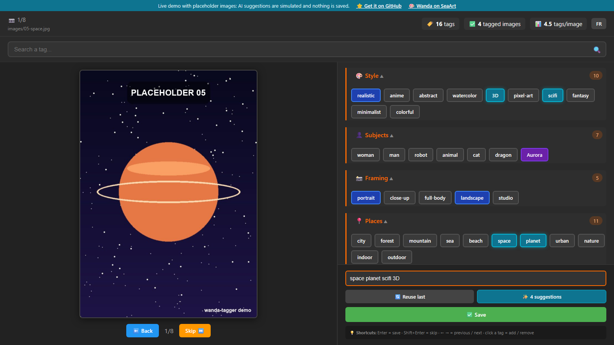

# Wanda Tagger

**Une interface web locale pour taguer rapidement un dossier d'images, avec des suggestions de tags par Claude, et un script qui tague tout un dossier à votre place.**

[**▶ Essayer la démo en ligne**](https://fmenguy.github.io/wanda-tagger/?lang=fr) (images factices, IA simulée) · [Mes créations sur SeaArt](https://www.seaart.ai/user/531aa6f7e28e2ad661b3c20b32ff46f7?u_code=FDOJP29Z) · [English version](README.md)



Je l'ai écrit pour taguer la galerie d'art IA de [wanda-aiart.org](https://wanda-aiart.org) : quelques centaines d'images, un vocabulaire de tags personnel, et un site statique qui lit un seul fichier JSON. Si vous rangez vos images dans des dossiers et voulez des tags cherchables sans base de données ni service en ligne, il devrait vous convenir aussi.

**Vous venez de SeaArt ?** Si vous téléchargez vos générations (ou des images qui vous ont plu) depuis [SeaArt](https://www.seaart.ai/user/531aa6f7e28e2ad661b3c20b32ff46f7?u_code=FDOJP29Z) et qu'elles s'entassent dans un dossier, donnez ce dossier à l'outil : `auto_tag.py` tague tout le lot, ensuite vous le parcourez par style, personnage ou ambiance. Mon espace SeaArt est [ici](https://www.seaart.ai/user/531aa6f7e28e2ad661b3c20b32ff46f7?u_code=FDOJP29Z), passez dire bonjour.

## Ce qu'il fait

- **Tout au clavier.** Une image à la fois, on tape les tags ou on clique dessus, `Entrée` enregistre et passe à la suivante, `Maj+Entrée` saute l'image.
- **Votre vocabulaire, rangé.** Les tags sont groupés dans des catégories repliables que vous définissez. Tags populaires, tags NSFW et noms propres ont chacun leur couleur. Un champ de recherche filtre le tout.
- **Des suggestions IA qui restent dans votre vocabulaire.** Claude regarde l'image et ne choisit que parmi vos tags existants : vous n'aurez jamais `sea`, `ocean` et `seaside` en même temps.
- **Mode automatique.** `auto_tag.py` tague toutes les images sans tags en une fois, puis `tagger.py --review` permet de les relire et de les corriger une par une.
- **Un simple fichier JSON.** Tout atterrit dans un `metadata.json`, facile à lire depuis n'importe quel générateur de site statique ou script.
- **Prudent par défaut.** La suppression est désactivée tant que vous ne l'activez pas, et même alors les fichiers sont déplacés dans un dossier `.trash/`, jamais effacés.
- **Interface en français et en anglais**, modifiable à tout moment.

## Démarrage rapide

Python 3.10 ou plus récent.

```bash
git clone https://github.com/fmenguy/wanda-tagger.git
cd wanda-tagger
pip install -r requirements.txt
python tagger.py
```

Ouvrir http://localhost:5000. Sans configuration personnelle, l'outil ouvre la démo fournie (12 images factices dans `demo/`).

Pour les suggestions IA, créer un fichier `.env` à côté de `tagger.py` (ou de votre `config.json`) :

```
ANTHROPIC_API_KEY=sk-ant-...
```

La clé s'obtient sur [console.anthropic.com](https://console.anthropic.com). L'outil fonctionne sans, seul le bouton de suggestion en a besoin.

## Sur vos propres images

1. Copier `demo/config.json` en `config.json` dans le dossier de vos images (ou ailleurs, voir `--config`).
2. Adapter `images_dir`, `metadata_file` et vos `categories`.
3. Lancer `python /chemin/vers/wanda-tagger/tagger.py` depuis ce dossier, ou `python tagger.py --config /chemin/vers/config.json`.

### Tagging automatique

```bash
python auto_tag.py --dry-run        # affiche ce qui serait tagué, n'écrit rien
python auto_tag.py                  # tague toutes les images sans tags
python auto_tag.py --only 2024/05   # seulement un sous-dossier de images_dir
python auto_tag.py --limit 20       # s'arrête après 20 images
python tagger.py --review           # relire les images taguées automatiquement
```

Les images taguées par le script reçoivent `"auto": true` dans les métadonnées. Les enregistrer dans l'interface de relecture retire la marque : on sait toujours ce qu'un humain a vérifié. Le script enregistre après chaque image, on peut l'arrêter à tout moment et le relancer plus tard.

## Configuration

Tous les chemins sont relatifs au dossier qui contient `config.json`.

| Clé | Défaut | Rôle |
| :-- | :-- | :-- |
| `images_dir` | `"images"` | Dossier parcouru récursivement |
| `metadata_file` | `"metadata.json"` | Fichier où sont stockés les tags |
| `extensions` | `.avif .webp .png .jpg .jpeg` | Types de fichiers à taguer |
| `language` | `"en"` | Langue par défaut de l'interface (`en` ou `fr`) |
| `categories` | `{}` | `{"Nom de catégorie": ["tag", ...]}`, affichées dans cet ordre. Les tags hors catégorie vont dans « Autres » |
| `category_labels` | `{}` | Traductions facultatives des noms de catégories, par exemple `{"fr": {"Places": "Lieux"}}` |
| `popular_tags` | `[]` | Surlignés en bleu |
| `nsfw_tags` | `[]` | Surlignés en rouge, et toujours proposés à l'IA avec la consigne explicite de les utiliser |
| `allow_delete` | `false` | Affiche un bouton Supprimer qui déplace l'image dans `.trash/` |
| `model` | `"claude-haiku-5-5"` | Modèle Claude utilisé pour les suggestions |
| `effort` | `"low"` | Effort du modèle. Mettre `null` pour les modèles sans ce réglage, comme `claude-haiku-4-5` |
| `max_suggestions` | `8` | Nombre maximum de tags suggérés par image |
| `candidate_tags_limit` | `80` | Nombre de vos tags les plus utilisés proposés au modèle, en plus des tags des catégories |

### Format des métadonnées

```json
{
  "images/2024/05/cat.avif": { "tags": ["animal", "cat", "portrait"] },
  "images/2024/05/city.avif": { "tags": ["city", "night"], "auto": true }
}
```

Les clés sont des chemins relatifs au dossier de la config. Renommer ou déplacer une image sans mettre à jour sa clé lui fait perdre ses tags.

## Coût et confidentialité

- Les images ne quittent pas votre machine, sauf celle pour laquelle vous demandez une suggestion : elle est réduite à 1568 px maximum et envoyée à l'API d'Anthropic.
- Avec Claude Haiku 5.5, une suggestion coûte environ deux dix-millièmes de dollar, soit à peu près 0,20 USD pour 1 000 images (tarifs au moment de l'écriture, voir [la page des tarifs](https://www.anthropic.com/pricing)).
- Le modèle peut refuser certaines images. Elles restent simplement sans tags, à taguer à la main.

## Organisation du projet

```
tagger.py           interface web (Flask) et sa petite API JSON
auto_tag.py         tagging automatique en ligne de commande
suggest.py          l'appel à Claude, partagé par les deux
store.py            config, recherche des images, fichier de métadonnées
web/                l'interface (HTML, CSS, JS sans framework, traductions dans i18n.js)
web/demo.js         faux serveur dans le navigateur, utilisé par la démo en ligne
demo/               images factices, config et métadonnées d'exemple
demo/make_placeholders.py   redessine les images factices
```

La démo en ligne est la même interface servie par GitHub Pages : `web/demo.js` remplace l'API Flask par une version en mémoire avec des suggestions précalculées. Ajouter `?demo` à l'URL pour l'obtenir en local avec n'importe quel serveur statique.

## Licence

[MIT](LICENSE)
