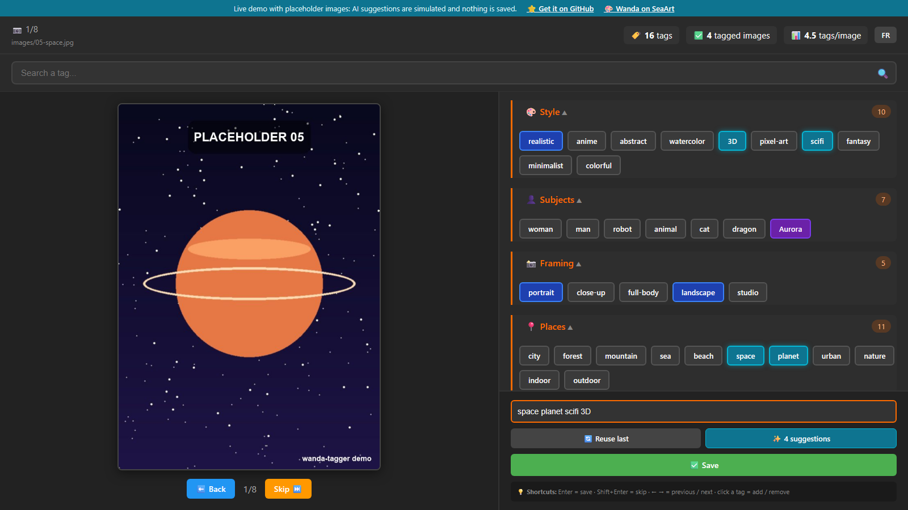

# Wanda Tagger

**A local web interface to tag a folder of images fast, with tag suggestions from Claude, plus a batch script that tags a whole folder for you.**

[**▶ Try the live demo**](https://fmenguy.github.io/wanda-tagger/) (placeholder images, simulated AI) · [My AI art on SeaArt](https://www.seaart.ai/user/531aa6f7e28e2ad661b3c20b32ff46f7?u_code=FDOJP29Z) · [Version française](README.fr.md)



I built it to tag the AI art gallery of [wanda-aiart.org](https://wanda-aiart.org): a few hundred images, a personal vocabulary of tags, and a static site that reads one JSON file. If you keep images in folders and want searchable tags without a database or a cloud service, it should fit you too.

**Coming from SeaArt?** If you download your generations (or images you liked) from [SeaArt](https://www.seaart.ai/user/531aa6f7e28e2ad661b3c20b32ff46f7?u_code=FDOJP29Z) and they pile up in a folder, point the tool at that folder: `auto_tag.py` tags the whole batch, then you browse it by style, character or mood. My own SeaArt space is [here](https://www.seaart.ai/user/531aa6f7e28e2ad661b3c20b32ff46f7?u_code=FDOJP29Z), say hi.

## What it does

- **Keyboard first tagging.** One image at a time, type tags or click them, `Enter` saves and moves on, `Shift+Enter` skips.
- **Your vocabulary, organised.** Tags are grouped in collapsible categories you define. Popular tags, NSFW tags and proper names get their own colors. A search box filters everything.
- **AI suggestions that stay in your vocabulary.** Claude looks at the image and only picks tags from your existing list, so you never end up with `sea`, `ocean` and `seaside` at the same time.
- **Batch mode.** `auto_tag.py` tags every untagged image in one run, then `tagger.py --review` lets you check and fix them one by one.
- **Plain JSON output.** Everything lands in a single `metadata.json`, easy to read from any static site generator or script.
- **Safe by default.** Deleting is off unless you enable it, and even then files are moved to a `.trash/` folder, never erased.
- **English and French interface**, switchable at any time.

## Quick start

Python 3.10 or later.

```bash
git clone https://github.com/fmenguy/wanda-tagger.git
cd wanda-tagger
pip install -r requirements.txt
python tagger.py
```

Open http://localhost:5000. Without a config of your own, the tool opens the bundled demo (12 placeholder images in `demo/`).

To use the AI suggestions, create a `.env` file next to `tagger.py` (or next to your `config.json`):

```
ANTHROPIC_API_KEY=sk-ant-...
```

Get a key at [console.anthropic.com](https://console.anthropic.com). The tool works fine without one, only the suggest button needs it.

## Use it on your own images

1. Copy `demo/config.json` to `config.json` in the folder where your images live (or anywhere, see `--config`).
2. Edit `images_dir`, `metadata_file` and your `categories`.
3. Run `python /path/to/wanda-tagger/tagger.py` from that folder, or `python tagger.py --config /path/to/config.json`.

### Batch tagging

```bash
python auto_tag.py --dry-run        # show what would be tagged, write nothing
python auto_tag.py                  # tag every untagged image
python auto_tag.py --only 2024/05   # only a sub-folder of images_dir
python auto_tag.py --limit 20       # stop after 20 images
python tagger.py --review           # check the images tagged automatically
```

Images tagged by the script get `"auto": true` in the metadata. Saving one in the review interface removes the flag, so you always know what a human has checked. The script saves after each image: you can stop it at any time and start again later.

## Configuration

All paths are relative to the folder that contains `config.json`.

| Key | Default | Meaning |
| :-- | :-- | :-- |
| `images_dir` | `"images"` | Folder scanned recursively for images |
| `metadata_file` | `"metadata.json"` | Where tags are stored |
| `extensions` | `.avif .webp .png .jpg .jpeg` | File types to tag |
| `language` | `"en"` | Default interface language (`en` or `fr`) |
| `categories` | `{}` | `{"Category name": ["tag", ...]}`, shown in this order. Tags in no category go to "Other" |
| `category_labels` | `{}` | Optional translations of category names, e.g. `{"fr": {"Places": "Lieux"}}` |
| `popular_tags` | `[]` | Highlighted in blue |
| `nsfw_tags` | `[]` | Highlighted in red, and always offered to the AI with an explicit instruction to use them |
| `allow_delete` | `false` | Shows a Delete button that moves the image to `.trash/` |
| `model` | `"claude-haiku-5-5"` | Claude model used for suggestions |
| `effort` | `"low"` | Model effort. Set to `null` for models without the effort setting, such as `claude-haiku-4-5` |
| `max_suggestions` | `8` | Maximum number of suggested tags per image |
| `candidate_tags_limit` | `80` | How many of your most used tags are offered to the model, on top of the category tags |

### Metadata format

```json
{
  "images/2024/05/cat.avif": { "tags": ["animal", "cat", "portrait"] },
  "images/2024/05/city.avif": { "tags": ["city", "night"], "auto": true }
}
```

Keys are paths relative to the config folder. Renaming or moving an image without updating its key loses its tags.

## Cost and privacy

- Images never leave your machine, except the one you ask a suggestion for: it is downscaled to 1568 px at most and sent to the Anthropic API.
- With Claude Haiku 5.5, a suggestion costs about two ten-thousandths of a dollar, so roughly 0.20 USD per 1,000 images (prices at the time of writing, check [the pricing page](https://www.anthropic.com/pricing)).
- The model may decline some images. They are simply left untagged for you to tag by hand.

## Project layout

```
tagger.py           web interface (Flask) and its small JSON API
auto_tag.py         batch tagging from the command line
suggest.py          the Claude call, shared by both
store.py            config, image discovery, metadata file
web/                the interface (HTML, CSS, vanilla JS, translations in i18n.js)
web/demo.js         in-browser fake backend used by the online demo
demo/               placeholder images, sample config and metadata
demo/make_placeholders.py   redraws the placeholder images
```

The online demo is the same interface served by GitHub Pages: `web/demo.js` replaces the Flask API with an in-memory version and precomputed suggestions. Add `?demo` to the URL to get it locally with any static server.

## License

[MIT](LICENSE)
